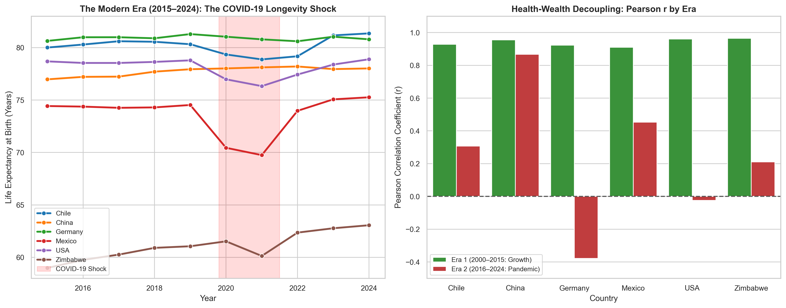
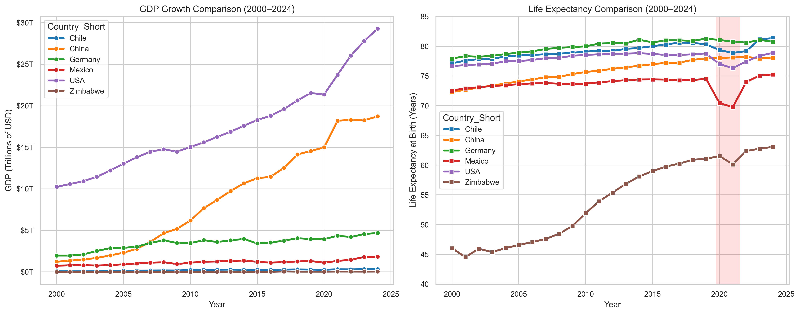
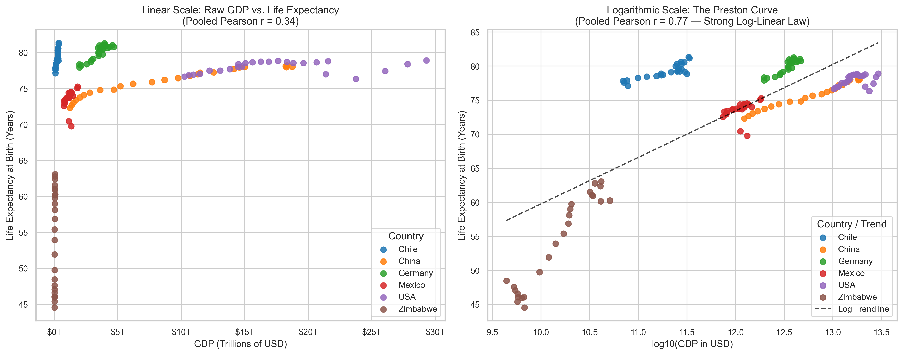
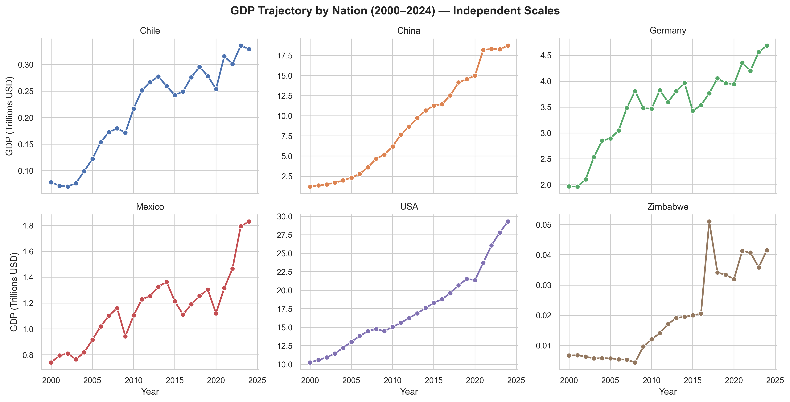
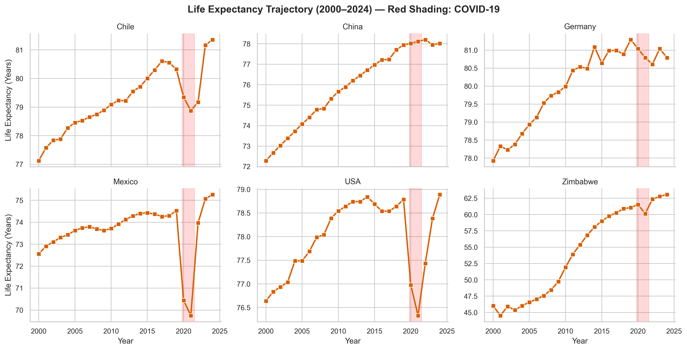
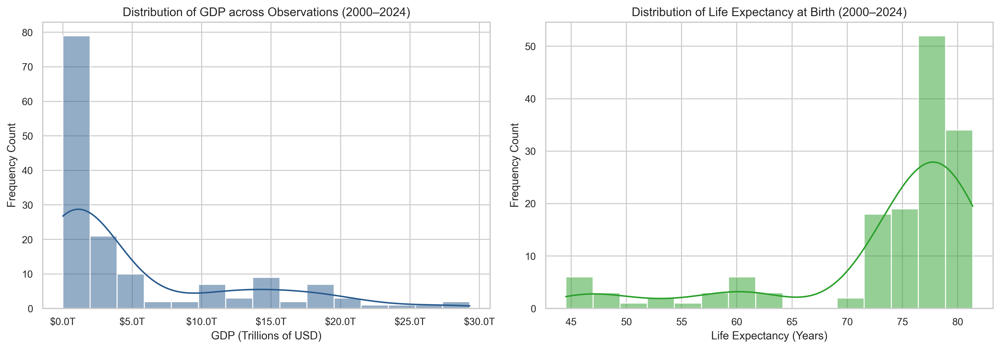
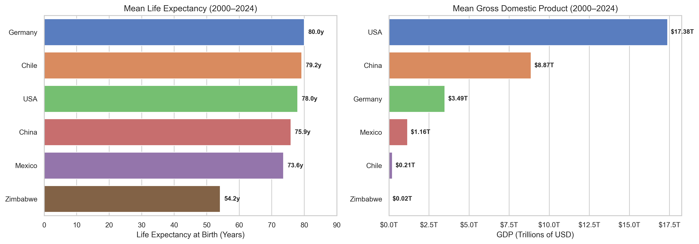

# 🌍 Life Expectancy and GDP: A Quarter-Century Empirical Study & Pandemic Shock Analysis (2000–2024)

[](https://www.python.org/)
[](https://pandas.pydata.org/)
[](https://seaborn.pydata.org/)
[](https://jupyter.org/)
[](https://data.worldbank.org/)
[](https://opensource.org/licenses/MIT)

An empirical investigation into the longitudinal relationship between Gross Domestic Product (GDP) and Life Expectancy at birth across six diverse nations (**Chile, China, Germany, Mexico, the United States, and Zimbabwe**) across **a quarter-century (2000–2024)**.

While standard portfolio studies examine only a static 2000–2015 dataset, this project investigates the full historical trajectory up to 2024 using the **World Bank Open Data API**. It divides the past 25 years into two contrasting historical eras:
1. **Era 1 (2000–2015): The Continuous Growth & Convergence Era** — Stable GDP expansion, rising life expectancy, and empirical validation of the classic **Preston Curve**.
2. **Era 2 (2016–2024): The Pandemic Shock & Decoupling Era** — The demographic disruption of the COVID-19 pandemic, sharp longevity declines in advanced economies, and the subsequent **health-wealth decoupling**.

---

## 📌 Two-Era Comparative Summary (2000–2024)

| Country | LE (2000) | LE (2015) | LE (2019) | COVID Low (2020–22) | Pandemic Shock ($\Delta$) | LE (2024) | GDP (2000) | GDP (2024) | $r$ Era 1 (00–15) | $r$ Era 2 (16–24) |
| :--- | :---: | :---: | :---: | :---: | :---: | :---: | :---: | :---: | :---: | :---: |
| **Chile** | 77.1 yrs | 80.0 yrs | 80.3 yrs | 78.9 yrs | **-1.45 yrs** | **81.4 yrs** | $78.3 B | $329.3 B | **+0.928** | **+0.308** |
| **Germany** | 77.9 yrs | 80.6 yrs | 81.3 yrs | 80.6 yrs | **-0.68 yrs** | **80.8 yrs** | $1,967.0 B | $4,685.6 B | **+0.923** | **-0.378** |
| **USA** | 76.6 yrs | 78.7 yrs | 78.8 yrs | 76.3 yrs | **-2.46 yrs** | **78.9 yrs** | $10,251.0 B | $29,298.0 B | **+0.961** | **-0.024** |
| **China** | 72.3 yrs | 77.0 yrs | 77.9 yrs | 78.0 yrs | *+0.08 yrs* | **78.0 yrs** | $1,223.8 B | $18,729.7 B | **+0.955** | **+0.867** |
| **Mexico** | 72.6 yrs | 74.4 yrs | 74.5 yrs | 69.8 yrs | **-4.78 yrs** | **75.3 yrs** | $742.1 B | $1,830.5 B | **+0.910** | **+0.453** |
| **Zimbabwe** | 46.0 yrs | 59.0 yrs | 61.1 yrs | 60.1 yrs | **-0.93 yrs** | **63.1 yrs** | $6.7 B | $41.5 B | **+0.964** | **+0.210** |

---

## 🔍 Major Research Findings

### 1. The COVID-19 Longevity Reversal
* Between 2019 and 2021, the global pandemic triggered unprecedented drops in life expectancy across high- and middle-income nations.
* **Mexico** suffered a devastating contraction of **-4.78 years** (falling to 69.8 years in 2021), before rebounding strongly to 75.3 years by 2024.
* **The United States** experienced a decline of **-2.46 years** (from 78.8 to 76.3 years) — the largest two-year longevity contraction in modern peacetime US history.
* **Chile and Germany** also registered notable dips (-1.45y and -0.68y), while **China's** zero-COVID policy delayed major mortality shocks until late 2022/2023.

### 2. The Health-Wealth Decoupling
* **Era 1 (2000–2015):** Every nation exhibited a near-perfect positive correlation ($r > 0.91$). Economic growth and longevity advanced hand in hand.
* **Era 2 (2016–2024):** This correlation completely broke down:
  * In the **USA**, Pearson $r$ collapsed from **+0.961** to **-0.024** (complete decoupling).
  * In **Germany**, the correlation inverted to **-0.378** (GDP continued growing from $3.9T to $4.7T while life expectancy dipped).
* **Econometric Takeaway:** During an acute global health emergency, aggregate national wealth and stimulus-driven GDP growth cannot instantly substitute for public health resilience, pathogen containment, and healthcare surge capacity.

### 3. The Preston Curve in Action
* Across the entire 25-year panel, a naive linear fit yields a weak pooled correlation of **$r = 0.28$**.
* When log-transformed ($\log_{10}(\text{GDP})$), the pooled correlation jumps to **$r = 0.77$**, confirming Samuel Preston's 1975 hypothesis of **diminishing marginal health returns to wealth**.

### 4. Long-Term Champions (2000–2024)
* **Greatest Longevity Gain:** **Zimbabwe** gained **+17.1 years** (46.0y to 63.1y), following the expansion of international antiretroviral therapy (ART) and malaria interventions.
* **Greatest Economic Expansion:** **China's** GDP surged from **$1.22 Trillion to $18.73 Trillion (+1,430%)**, transitioning into an upper-middle-income economy.

---

## 📊 Visual Gallery

### 1. The Pandemic Shock & Health-Wealth Decoupling (2015–2024)
Visualizing the acute COVID-19 longevity dip alongside the collapse of the correlation coefficient ($r$) in Era 2:



---

### 2. Macro Trends across the Quarter-Century (2000–2024)
Comparing the diverging economic scales alongside the convergence in longevity:



---

### 3. The Preston Curve: Linear vs. Logarithmic Law
Why log-transforming GDP linearizes cross-national health economics:



---

### 4. Country-by-Country Trajectories (Independent Scales)

| GDP Trajectories (2000–2024) | Life Expectancy Trajectories (COVID-19 in Red) |
| :---: | :---: |
|  |  |

---

### 5. Baseline Distributions & Long-Term Averages

| Univariate Distributions (2000–2024) | 25-Year National Averages |
| :---: | :---: |
|  |  |

---

## 📂 Project Structure

```text
life-expectancy-and-gdp/
├── all_data.csv                 # Original 2000–2015 baseline dataset
├── all_data_extended.csv        # Extended 2000–2024 dataset (World Bank API)
├── fetch_worldbank_data.py      # Automated World Bank API data ingestion script
├── life_expectancy_gdp.ipynb    # Comprehensive 2-Part interactive Jupyter Notebook
├── analysis.py                  # Standalone CLI analysis & figure generation pipeline
├── requirements.txt             # Python dependencies
├── pyproject.toml               # Python project configuration
├── LICENSE                      # MIT Open Source License
├── .gitignore                   # Clean repository ignore rules
├── figures/                     # 7 High-resolution (300 DPI) exported visualizations
│   ├── 1_distributions.png
│   ├── 2_country_averages.png
│   ├── 3_gdp_trends_faceted.png
│   ├── 4_life_expectancy_trends_faceted.png
│   ├── 5_combined_macro_trends.png
│   ├── 6_preston_curve_analysis.png
│   └── 7_era_comparison_covid_shock.png
└── README.md                    # Project documentation
```

---

## 🛠️ Installation & Quickstart

### 1. Clone the repository
```bash
git clone https://github.com/your-username/life-expectancy-and-gdp.git
cd life-expectancy-and-gdp
```

### 2. Set up environment
```bash
python3 -m venv .venv
source .venv/bin/activate  # On Windows: .venv\Scripts\activate
pip install -r requirements.txt
```

### 3. Fetch latest data (Optional)
To pull fresh, live data from the World Bank API:
```bash
python fetch_worldbank_data.py
```

### 4. Run the full analysis pipeline
Generates all statistical metrics and exports all 7 figures to `figures/`:
```bash
python analysis.py
```

### 5. Launch the Jupyter Notebook
Walk through the interactive 2-part empirical analysis:
```bash
jupyter notebook life_expectancy_gdp.ipynb
```

---

## 📖 Methodology & Indicators

Data is sourced from the **World Bank Open Data API**:

| Indicator Code | Name | Unit | Source |
| :--- | :--- | :--- | :--- |
| `SP.DYN.LE00.IN` | Life expectancy at birth, total | Years | World Bank / WHO Global Health Observatory |
| `NY.GDP.MKTP.CD` | GDP (current US$) | Current U.S. Dollars | World Bank national accounts data |

### Analytical Framework
* **Epoch Segmentation:** Split into Era 1 (2000–2015) and Era 2 (2016–2024) to evaluate structural stability before and during the pandemic.
* **Log-Linear Econometrics:** Testing the concavity of the health production function ($\text{LE} = \beta_0 + \beta_1 \log_{10}(\text{GDP})$).
* **Decoupling Metrics:** Pearson product-moment correlation tracking over time.

---

## 📚 References
* Preston, S. H. (1975). *The Changing Relation between Mortality and Level of Economic Development*. Population Studies, 29(2), 231–248.
* World Bank. (2024). *World Development Indicators: GDP and Life Expectancy Data*.
* World Health Organization. (2024). *The Global Health Observatory*.

---

## 📄 License
This project is open-source under the [MIT License](LICENSE).
